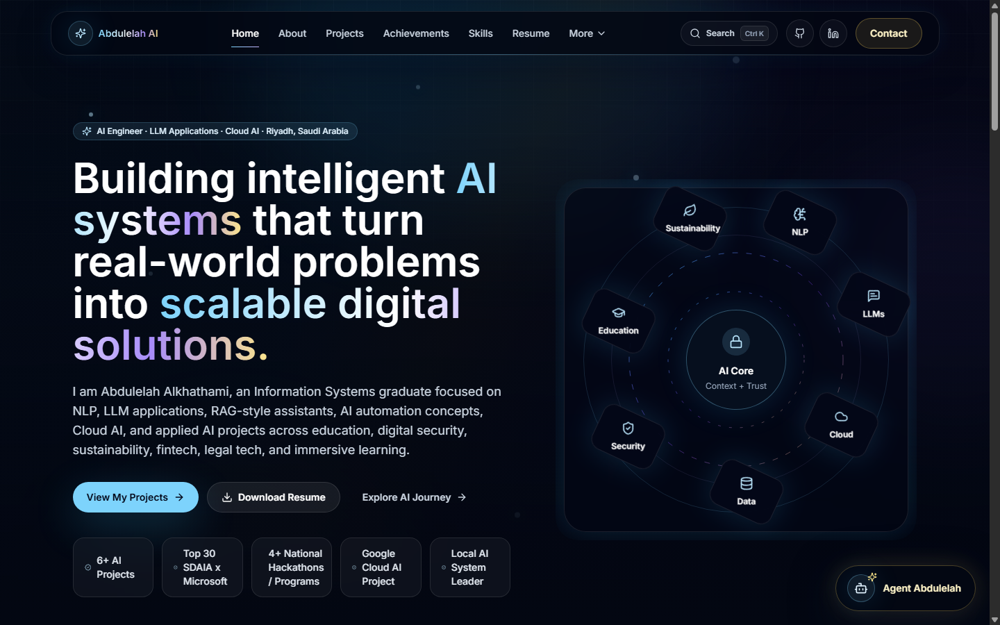

<a href="https://github.com/Abdulel3h">
  <picture>
    <source media="(max-width: 600px)" srcset="assets/terminal-mobile.svg">
    
  </picture>
</a>

**A bilingual portfolio where the pages and the embedded assistant answer from the same typed facts, so they cannot drift apart.**

Deployed at [abdulelah.de](https://www.abdulelah.de) in English and Arabic. Next.js 16 App Router with TypeScript.

###### HOW IT WORKS

1. **One source of facts.** `data/site.ts` and `data/projects.ts` hold identity, links and every project in both languages, each with an evidence-based status.
2. **Pages render from it.** App Router pages compose those facts; Arabic lives under `/ar` on the same routes.
3. **The assistant answers from it.** `lib/agent/*` maps visitor questions to the same data through server-only routes, so keys never reach the browser.
4. **Metadata derives from it.** Sitemap with hreflang, robots, JSON-LD and Open Graph come from the same content.

###### EVIDENCE

- Eight projects with explicit statuses, counted in the hero: two working prototypes, two hackathon prototypes, one graduation project and three concepts. Nothing is presented as in production.
- English and Arabic versions of every public page, with localized metadata, canonical URLs and a bilingual sitemap
- A bilingual assistant grounded in the same data, loaded on demand
- A contact form with shared server and client validation and delivery through Resend
- Cookieless Vercel Web Analytics and real-user LCP, INP and CLS
- WCAG 2.2 AA-oriented UI: skip link, visible focus, contrast-checked tokens, reduced-motion support
- Vitest unit tests and Playwright end-to-end tests with axe accessibility checks

**Not claimed:** the code-drawn project previews on the site are labelled concept visualizations, and Qanouni, Medad and Virtual Astronauts have no public code. [All limitations](docs/overview.md#limitations)

<details>
<summary>Screenshot</summary>



Captured from the live portfolio homepage.
</details>

###### QUICK START

```bash
npm install
cp .env.example .env.local
npm run dev
```

Open `http://localhost:3000`. Checks:

```bash
npm run lint        # ESLint (Next core-web-vitals + TypeScript rules)
npm run typecheck   # tsc --noEmit
npm test            # Vitest unit tests (routing, content evidence, contact validation, SEO)
npm run build
npm run test:e2e    # Playwright + axe against the production build (uses the installed Chrome)
```

The assistant and contact delivery are optional: without keys the site runs and those routes degrade instead of breaking. [Environment variables](docs/overview.md#quick-start)

###### DOCUMENTATION

[Overview](docs/overview.md) · [Architecture](docs/architecture.md) · [Case study](docs/case-study.md) · [Content guidelines](docs/content-guidelines.md) · [Design system](docs/design-system.md) · [Engineering principles](docs/engineering-principles.md) · [Technical decisions](docs/technical-decisions.md) · [Reviewer guide](docs/reviewer-guide.md)

<sub>[Abdulelah Alkhathami](https://github.com/Abdulel3h) · [abdulelah.de](https://www.abdulelah.de) · No license file yet, so all rights are reserved by default.</sub>
